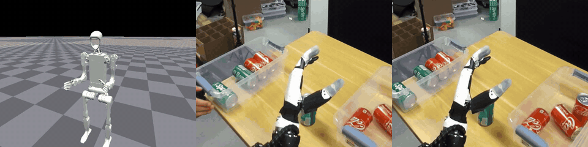

# OpenTV-Sim-Repro：Open-TeleVision 仿真复现（RTX 50 系列适配）

> **声明：本仓库不是官方仓库。** 本仓库基于 [OpenTeleVision/TeleVision](https://github.com/OpenTeleVision/TeleVision)（CoRL 2024）修改，用于在 RTX 50 系列显卡（Blackwell / sm_120）上复现仿真侧的模仿学习流程。原始代码、模型设计和数据集的全部功劳归原作者所有。使用本仓库时，请引用原论文（见文末[引用](#引用)）。
>
> 完整的复现过程、踩坑记录和仿真效果见 [docs/reproduction-guide.md](docs/reproduction-guide.md)。

## 许可证与致谢

本仓库沿用原仓库的 **Apache License 2.0**，完整条款见 [`LICENSE`](LICENSE)。

- **原作者版权**：Copyright 2024 Xuxin Cheng, Jialong Li, Shiqi Yang, Ge Yang and Xiaolong Wang。
- **原项目依赖的开源代码**（各自许可证请见对应仓库）：
  1. [tonyzhaozh/act](https://github.com/tonyzhaozh/act)
  2. [facebookresearch/detr](https://github.com/facebookresearch/detr)
  3. [dexsuite/dex-retargeting](https://github.com/dexsuite/dex-retargeting)
  4. [vuer-ai/vuer](https://github.com/vuer-ai/vuer)
- **本版本额外依赖**：[facebookresearch/dinov2](https://github.com/facebookresearch/dinov2)（Apache License 2.0）。本仓库不包含它的代码，需要按[准备 DINOv2](#准备-dinov2)单独下载。
- **数据集**：由原作者提供，不随本仓库分发，下载方式见[数据集](#数据集)。

按照 Apache License 2.0 第 4 条的要求，本仓库保留了原 `LICENSE` 文件和全部版权声明，修改过的文件列在下一节。

## 相对原版的修改

本版本只涉及仿真侧的模仿学习流程：数据预处理 → ACT 训练 → JIT 导出 → 仿真推理可视化。遥操作相关代码（`teleop/`）没有改动，也没有验证，如需使用请参考[官方 README](https://github.com/OpenTeleVision/TeleVision#readme)。

| 文件 | 改动 | 原因 |
|------|------|------|
| `act/detr/models/backbone.py` | 从本地 `dinov2` 目录加载 DINOv2，不再从 GitHub 拉取 main 分支 | 新版 DINOv2 的 hub 代码使用了 Python 3.10 语法，与 Python 3.8 环境不兼容 |
| `act/utils.py` | DataLoader 的 `num_workers` 从 24/16 改为 4/2 | 避免 16GB 内存的笔记本内存不足 |
| `act/imitate_episodes.py` | `dataset_stats.pkl` 改为保存 Python list；checkpoint 用 `map_location='cpu'` 加载；JIT 改在 CPU 上 trace | 让 `tv` 环境（numpy 1.x、旧版 PyTorch）能读取 `tv_train` 环境的产物 |
| `scripts/deploy_sim.py` | 策略推理改在 CPU 上运行；加载 stats 时转换为 numpy 数组；新增 `--record`；逐帧读取图像，时间聚合改用滚动缓冲 | `tv` 环境中的旧版 PyTorch 无法在 sm_120 上执行 CUDA kernel；便于保存仿真效果；内存占用从约 15GB 降到约 4GB |
| `scripts/replay_demo.py` | `Player` 支持用离屏相机录制 mp4 | 为 `--record` 提供实现 |
| `.gitignore` | 忽略 `data/`；对 `docs/images/`、`docs/videos/` 取消图片和视频的忽略规则 | 数据集和 checkpoint 体积超过 100GB，不应提交；文档中的截图和演示视频需要提交 |
| `README.md` | 重写为本版本说明 | — |
| `docs/`（新增） | 复现记录文章、截图、演示 GIF 和完整仿真视频 | 记录复现过程和仿真效果 |

## 仿真效果

左侧是 Isaac Gym 中由 ACT 策略驱动的 H1 机器人，右侧是数据集中的左右目图像：



完整视频（约 85 秒）：[docs/videos/deploy_sim_17000.mp4](docs/videos/deploy_sim_17000.mp4)

## 环境

验证环境：Ubuntu，RTX 5060 Laptop（8GB 显存），16GB 内存。

RTX 50 系列需要 PyTorch ≥ 2.7（CUDA 12.8），这些版本没有 Python 3.8 的安装包；而 Isaac Gym Preview 4 只支持 Python ≤ 3.8。因此训练和仿真拆到两个 conda 环境：

| 环境 | Python | PyTorch | 用途 |
|------|--------|---------|------|
| `tv` | 3.8 | 2.3（`requirements.txt`） | 数据预处理（ZED）、仿真推理（Isaac Gym） |
| `tv_train` | 3.11 | 2.11（cu128） | ACT 训练、JIT 导出 |

### 准备 DINOv2

`backbone.py` 会从**与 `TeleVision` 同级的 `dinov2` 目录**加载模型：

```bash
# 在 TeleVision 的上一级目录执行
git clone https://github.com/facebookresearch/dinov2.git
cd dinov2 && git checkout b48308a
```

```text
parent_dir/
├── TeleVision/
└── dinov2/        # 固定在 b48308a
```

首次运行时，`dinov2_vits14` 的预训练权重会自动下载到 `~/.cache/torch/hub/checkpoints/`。

### 安装

**`tv`（预处理 / 仿真）**

```bash
conda create -n tv python=3.8
conda activate tv
pip install -r requirements.txt
cd act/detr && pip install -e .
# Isaac Gym Preview 4：https://developer.nvidia.com/isaac-gym/
cd /path/to/isaacgym/python && pip install -e .
# ZED SDK：https://www.stereolabs.com/developers/release/
# post_process.py 读取 .svo 需要 ZED Python API
cd /usr/local/zed/ && python get_python_api.py
```

**`tv_train`（训练 / 导出）**

```bash
conda create -n tv_train python=3.11
conda activate tv_train
pip install torch torchvision --index-url https://download.pytorch.org/whl/cu128
pip install 'numpy<2.1' einops h5py opencv-python matplotlib tqdm PyYAML scikit-learn IPython wandb packaging
cd act/detr && pip install -e .
```

检查显卡是否可用，输出的架构列表中应包含 `sm_120`：

```bash
python -c "import torch; print(torch.__version__, torch.cuda.get_device_name(0), torch.cuda.get_arch_list())"
```

## 数据集

本次只使用了 `00-can-sorting`（易拉罐分拣，约 2.36GB）。从原作者的 [Google Drive](https://drive.google.com/drive/folders/11WO96mUMjmxRo9Hpvm4ADz7THuuGNEMY?usp=sharing) 下载后，放到 `data/recordings/00-can-sorting/` 下。

打包下载时 Google Drive 可能因为文件太大无法完成病毒扫描而卡住，可以进入目录逐个下载文件。

## 运行流程

```bash
# 1. 预处理（tv）
conda activate tv
cd scripts && python post_process.py

# 2. 训练（tv_train）
conda activate tv_train
cd ../act
python imitate_episodes.py --policy_class ACT --kl_weight 10 --chunk_size 60 \
  --hidden_dim 512 --batch_size 8 --dim_feedforward 3200 --num_epochs 30000 \
  --lr 5e-5 --seed 0 --taskid 00 --exptid 01 --no_wandb

# 3. 导出 JIT（tv_train，填验证集 loss 最低的 checkpoint 编号）
python imitate_episodes.py --policy_class ACT --kl_weight 10 --chunk_size 60 \
  --hidden_dim 512 --batch_size 8 --dim_feedforward 3200 --num_epochs 30000 \
  --lr 5e-5 --seed 0 --taskid 00 --exptid 01 --no_wandb \
  --save_jit --resume_ckpt 17000

# 4. 仿真推理可视化（tv），加 --record 保存视频到 data/logs/00-can-sorting/01/deploy_sim_17000.mp4
conda activate tv
cd ../scripts
python deploy_sim.py --taskid 00 --exptid 01 --resume_ckpt 17000 --record
```

说明：

- `batch_size 8` 和 `num_epochs 30000` 是根据笔记本资源调整的（官方为 45 / 50000）。代码里的 `num_epochs` 实际表示优化步数。
- 训练结束时会打印验证集 loss 最低的 epoch，并另存为 `policy_best.ckpt`。导出时应填这个编号，不要照搬官方示例中的 `25000`。
- 每 1000 步保存一个约 360MB 的 checkpoint，30000 步约占 11GB 磁盘空间。
- 使用 `--no_wandb` 时不会保存 loss 曲线。

## 参考结果

| 项目 | 数值 |
|------|------|
| 训练速度 | 约 2.7 it/s（batch_size 8） |
| 30000 步耗时 | 约 3 小时 |
| 验证集最优 epoch | 17000 |
| 验证集 loss | 约 0.119（L1 约 0.117） |
| 仿真推理（CPU） | 约 3 帧/秒，内存约 4GB |

## 已知限制

- `deploy_sim.py` 是**开环可视化**：输入是数据集中录制好的图像和状态，Isaac Gym 场景里只有机器人和地面。它可以用来检查预测动作是否合理，不能代表任务成功率。
- 策略在 CPU 上推理，窗口播放明显慢于实时；`--record` 录制的视频按 60fps 写入，播放速度正常。
- 未做真机部署和任务成功率评估。

## 引用

```bibtex
@article{cheng2024tv,
title={Open-TeleVision: Teleoperation with Immersive Active Visual Feedback},
author={Cheng, Xuxin and Li, Jialong and Yang, Shiqi and Yang, Ge and Wang, Xiaolong},
journal={arXiv preprint arXiv:2407.01512},
year={2024}
}
```
