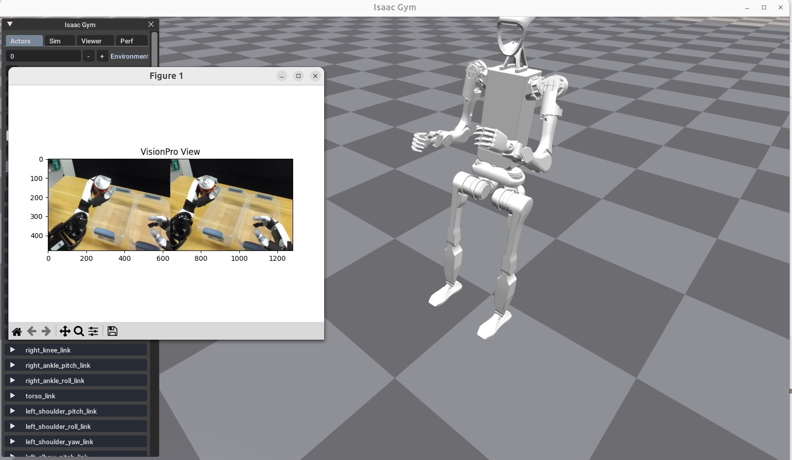
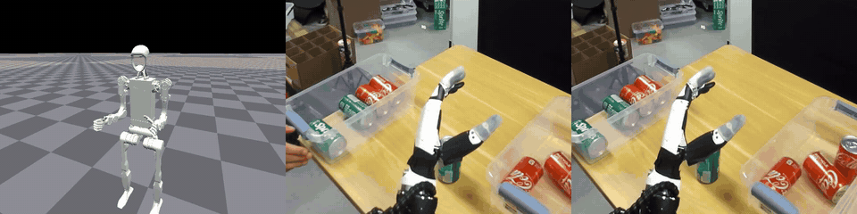

# Open-TeleVision 仿真复现：从数据集下载到 ACT 策略可视化

> 本文代码：[qiuleyao/OpenTV-Sim-Repro](https://github.com/qiuleyao/OpenTV-Sim-Repro)（基于官方仓库修改，适配 RTX 50 系列）
>
> 原项目：[OpenTeleVision/TeleVision](https://github.com/OpenTeleVision/TeleVision)
>
> 参考论文：[*Open-TeleVision: Teleoperation with Immersive Active Visual Feedback*](https://arxiv.org/abs/2407.01512)（CoRL 2024）
>
> 实验环境：Ubuntu，RTX 5060 Laptop（8GB 显存），16GB 内存
>
> 复现范围：数据集获取、数据预处理、ACT 模型训练、JIT 导出和 Isaac Gym 仿真推理。预处理用 ZED SDK 读取官方录制的 `.svo` 视频，不涉及 ZED 相机实际采集、真机遥操作和真机部署。

## 一、项目背景与参考教程

本次复现主要参考了 Open-TeleVision 遥操作实战教程：

📄 [Open-Television实战.docx](https://yv6uc1awtjc.feishu.cn/wiki/FX45wQU48i9fhZktP2hcny88nQc)

该教程介绍了 Open-TeleVision 项目的环境配置、数据集准备以及相关训练流程，为本次复现提供了基础指导。

需要说明的是，在实际操作过程中，本文并非对原教程的逐步照搬。由于本机采用 RTX 5060 Laptop，在环境配置、训练参数和部署方式上做了必要适配；具体差异与处理过程见后文。

### 1.1 Open-TeleVision 项目介绍

Open-TeleVision 是一个基于沉浸式视觉反馈的机器人遥操作项目。操作者可以借助 VR 设备观察机器人视角下的环境，并通过头部与手部运动追踪及动作映射，实现对机器人的实时遥操作控制。在此过程中采集到的示教数据，还可以进一步用于模仿学习，让机器人学习人类的操作方式。

本次复现主要关注项目中的模仿学习部分，即利用官方提供的遥操作示教数据训练机器人策略，并在仿真中观察训练结果。整个过程可分为五个阶段：

1. 获取示教数据：使用项目提供的遥操作数据集，其中包含人类示教时记录的图像、机器人状态和动作。

2. 数据预处理：将原始 `.svo` 与 `.hdf5` 按时间对齐，转换成 ACT 可用的训练格式。

3. ACT 训练：学习图像、机器人状态与目标动作之间的映射。

4. JIT 导出：将训练好的策略导出为部署可用的模型文件。

5. 仿真推理可视化：使用 `deploy_sim.py`，在 Isaac Gym 中观察模型预测动作。

因此，本次复现打通的是一条离线模仿学习流程：

示教数据 → 数据预处理 → ACT 训练 → JIT 导出 → Isaac Gym 仿真推理可视化

### 1.2 官方教程与本次复现的主要差异

| 项目 | 官方教程 | 本次复现 | 原因 |
|------|----------|----------|------|
| 运行环境 | 单一 `tv`（Py3.8） | `tv_train` + `tv` | Isaac Gym 仅支持 Py≤3.8；RTX 5060 需新版 PyTorch |
| `batch_size` | 45 | 8 | 降低显存/内存占用 |
| `num_epochs` | 50000 | 30000 | 缩短训练时间，效果通常已接近可用 |
| `exptid` | `01-sample-expt` | `01` | 本地实验命名简化 |
| 日志 | 默认 wandb | `--no_wandb` | 本地实验简化，关闭在线上报 |
| 部署 checkpoint | 示例 25000 | 验证最优 17000 | 按 val loss 自动选择，非固定示例编号 |
| JIT 导出 | 默认 CUDA | CPU trace | 兼容 `tv` 旧版 PyTorch 加载 |
| `deploy_sim` 推理 | 默认 CUDA | CPU | `tv` 无法在 RTX 5060 上做 CUDA 推理 |
| `dataset_stats.pkl` | 直接使用 | 做 numpy 兼容处理 | `tv_train`（numpy2）与 `tv`（numpy1）格式不兼容 |

通过这次复现，希望不仅能够跑通 Open-TeleVision 的仿真流程，也能进一步理解遥操作数据如何经过预处理进入模仿学习模型，以及训练好的策略如何在仿真环境中执行。

## 二、环境配置：为什么需要两个 Python 环境？

项目复现过程中，环境配置是首先需要解决的问题。

本次使用的设备为 NVIDIA RTX 5060 Laptop GPU（架构 sm_120）。实际复现时发现，训练与仿真相关流程所依赖的软件版本存在冲突。

一方面，ACT 模型训练需要能够支持新显卡架构的 PyTorch；另一方面，项目使用的 Isaac Gym Preview 4 对 Python 版本要求较严（通常为 Python 3.8）。若将两套依赖强行放在同一环境中，容易出现版本冲突。因此，最终采用两个 Conda 环境分别承担不同环节：

| 环境 | Python | 主要用途 |
|------|--------|----------|
| `tv_train` | 3.11 | ACT 模型训练、JIT 导出 |
| `tv` | 3.8 | 数据预处理、Isaac Gym 仿真与策略部署 |

其中，`tv_train` 使用支持当前显卡的新版 PyTorch（cu128）；`tv` 保留 Isaac Gym 所需的旧版依赖。

关于数据预处理放在 `tv` 中：本次将 ZED Python API 安装在 `tv`（Python 3.8）里，以便与预处理及 Isaac Gym 相关流程共用同一环境。需要说明的是，ZED SDK 本身并不只能安装在旧环境中；这里这样安排，主要是为了减少环境拆分带来的重复配置。

这种双环境方案并不是 Open-TeleVision 的唯一标准做法，而是针对本次硬件与软件条件做出的适配。

## 三、数据集获取：第一个实际遇到的麻烦

完成环境配置后，下一步是获取训练所需的数据集。

Open-TeleVision 项目提供了多个任务的数据，其中包括不同物体的抓取、操作等场景。考虑到完整数据集体积较大，本次没有下载全部任务（约16.72GB），而是选择了 `00-can-sorting`（约2.36GB），也就是不同颜色易拉罐分拣任务。

不过，数据集下载并没有想象中顺利。

项目提供的 Google Drive 下载入口中，任务数据以压缩包的形式提供。由于整个压缩包体积较大，Google Drive 在下载时无法完成病毒扫描，页面一直停留在下载中状态，导致无法正常通过常规方式下载整个压缩包。

尝试之后，最终采用了一个比较直接的办法：不再下载整个压缩包，而是进入网盘目录，将其中的文件逐个下载，其中对于无法完成病毒扫描，可能危害电脑的提示选择跳过仍要下载。

最终一共下载了 20 个文件，再将这些文件放入已经通过 Git 拉取的 TeleVision 仓库中新建的 `data` 目录下。

数据集所在最终的目录结构如下：

```text
data/
├── recordings/
│   └── 00-can-sorting/
│       ├── episode_0.hdf5                  # 原始数据：机器人状态与动作
│       ├── episode_0.svo                   # 原始数据：ZED 双目视频
│       ├── episode_1.hdf5
│       ├── episode_1.svo
│       ├── ...
│       ├── episode_9.hdf5
│       ├── episode_9.svo
│       └── processed/                      # post_process.py 输出，图像与状态已对齐
│           ├── processed_episode_0.hdf5
│           ├── ...
│           └── processed_episode_9.hdf5
└── logs/
    └── 00-can-sorting/
        └── 01/                             # 实验 01 的全部产物
            ├── dataset_stats.pkl           # 归一化统计量（list 格式，tv 环境可读）
            ├── dataset_stats.pkl.np2bak    # 原 numpy 2 格式备份
            ├── policy_epoch_0_seed_0.ckpt  # 每 1000 步保存一次
            ├── policy_epoch_1000_seed_0.ckpt
            ├── policy_epoch_2000_seed_0.ckpt
            ├── ...
            ├── policy_epoch_29000_seed_0.ckpt
            ├── policy_best.ckpt            # 验证集 loss 最低（epoch 17000）
            ├── policy_last.ckpt            # 最后一步
            ├── traced_jit_17000.pt         # 导出的 TorchScript 模型，供 deploy_sim.py 使用
            └── deploy_sim_17000.mp4        # 仿真推理录屏（--record 生成）
```

说明：

- `recordings/`：原始数据 + 预处理后的训练数据

- `logs/00-can-sorting/01/`：本次实验产物（checkpoint、统计量、JIT）

- `policy_epoch_*`：每 1000 步存一份，从 0 到 29000

**这次遇到的问题也提醒我：复现开源项目时，数据集获取本身就可能成为一个独立的工作环节。** 除了关注代码和依赖环境，还需要提前确认数据集的下载方式、目录结构以及文件是否完整。

## 四、数据预处理：将原始录制数据转换为训练数据

获取数据集之后，并不能直接开始训练。项目提供的原始数据还需要经过预处理，才能转换成 ACT 模型所需的输入格式。

本次使用的是仓库中的 `scripts/post_process.py`。

它主要负责将原始录制数据进行整理和对齐。输入包括每个 episode 对应的 `.svo` 视频文件和 `.hdf5` 机器人数据文件，处理后生成供模型训练使用的 HDF5 数据。

以 `00-can-sorting` 任务为例，处理前的数据主要位于：

```text
data/recordings/00-can-sorting/
```

处理后则会生成相应的 processed 数据文件。

其中比较重要的字段包括：

| 字段 | 含义 |
|------|------|
| `observation.image.left/right` | 左右目相机图像 |
| `observation.state` | 机器人当前状态 |
| `qpos_action` | 示教动作标签 |
| `cmds` | 与底层控制命令相关的数据 |

从模仿学习的角度来看，可以把这些数据理解为一组组训练样本：

- 图像和机器人状态提供当前环境信息。

- 示教动作提供人类希望机器人执行的目标动作。

ACT 模型就是通过学习这些输入与目标动作之间的关系，逐渐掌握示教任务。

## 五、ACT 模型训练：让机器人学习示教动作

完成数据预处理后，就可以进入模型训练阶段。

本次复现使用的是 ACT（Action Chunking with Transformers）。与每次只预测一个动作的方式不同，ACT 会预测一段连续的动作序列，也就是 Action Chunk。这种设计有助于模型学习具有时间连续性的操作行为。

训练脚本位于：

```text
act/imitate_episodes.py
```

本次训练使用的主要参数如下：

| 参数 | 本次设置 |
|------|----------|
| `policy_class` | ACT |
| `kl_weight` | 10 |
| `chunk_size` | 60 |
| `hidden_dim` | 512 |
| `batch_size` | 8 |
| `dim_feedforward` | 3200 |
| `num_epochs` | 30000 |
| `lr` | 5e-5 |
| `seed` | 0 |
| `taskid` | 00 |
| `exptid` | 01 |

完整训练命令（在 `tv_train` 环境中执行）：

```bash
conda activate tv_train
cd ~/robot_datasets/TeleVision/act

python imitate_episodes.py \
  --policy_class ACT \
  --kl_weight 10 \
  --chunk_size 60 \
  --hidden_dim 512 \
  --batch_size 8 \
  --dim_feedforward 3200 \
  --num_epochs 30000 \
  --lr 5e-5 \
  --seed 0 \
  --taskid 00 \
  --exptid 01 \
  --no_wandb
```

与教程中常见的配置相比，本次主要调整了 batch_size 和 num_epochs。

原配置中的 batch_size 为 45，本次调整为 8，主要是为了降低显存占用，使训练能够在当前设备上稳定运行。训练步数则设置为 30000，而不是直接使用教程中的 50000。

训练过程中还有一个值得注意的地方：代码中的 `num_epochs` 实际上对应模型的优化更新步数，并不是通常意义上完整遍历整个数据集一次所代表的 epoch。

训练脚本会定期进行验证，并记录验证集损失较好的模型；同时也会按照设定的间隔保存 checkpoint。因此，训练过程中会产生多个不同编号的模型文件。

本次训练的实际情况如下：

- 训练耗时约 3 小时。

- 实际训练速度约为 2.7 it/s。

- 验证集表现最好的 checkpoint 为 `17000`。

- 重新计算得到的验证集 loss 约为 0.119，其中 L1 loss 约为 0.117，KL loss 较小。

训练产物保存在：

```text
data/logs/00-can-sorting/01/
```

这里有一个容易产生误解的地方：教程中使用的 `resume_ckpt 25000` 只是示例，并不意味着每次训练都应该选择编号为 25000 的 checkpoint。

实际使用时，应该根据验证集表现选择模型。本次训练中，17000 步对应的 checkpoint 表现最好，因此后续部署也使用了这个版本。

## 六、模型导出：为什么还需要 JIT？

训练完成后，得到的是 PyTorch checkpoint 文件。但仿真部署脚本需要加载可以直接执行推理的策略模型，因此还需要进行一次模型导出。

本次使用 ACT 训练脚本提供的 `--save_jit` 参数，将选定的 checkpoint 导出为 TorchScript 格式。

导出时使用的 checkpoint 是前面验证集表现最好的 `17000`：

```bash
python imitate_episodes.py \
  --policy_class ACT \
  --kl_weight 10 \
  --chunk_size 60 \
  --hidden_dim 512 \
  --batch_size 8 \
  --dim_feedforward 3200 \
  --num_epochs 30000 \
  --lr 5e-5 \
  --seed 0 \
  --taskid 00 \
  --exptid 01 \
  --no_wandb \
  --save_jit \
  --resume_ckpt 17000
```

最终生成的文件为：

```text
data/logs/00-can-sorting/01/traced_jit_17000.pt
```

这里还遇到了一个与显卡兼容性有关的问题。

由于训练环境使用的新版本 PyTorch 支持 RTX 5060，而旧版仿真环境中的 PyTorch 不支持 sm_120 架构，因此不能简单地将 CUDA 上训练得到的模型直接放到旧环境中执行 GPU 推理。

本次采用的处理方式是在 CPU 上完成 JIT trace，并在仿真部署时使用 CPU 进行策略推理。这样可以绕开旧版 PyTorch 与新显卡之间的兼容性问题。

## 七、仿真部署：在 Isaac Gym 中观察策略动作

完成模型导出后，终于进入了整个复现流程中比较直观的部分：在 Isaac Gym 中观察训练好的 ACT 策略如何控制机器人。

这里使用的脚本是：

```text
scripts/deploy_sim.py
```

执行时需要切换到之前配置好的 `tv` 环境：

```bash
conda activate tv

cd ~/robot_datasets/TeleVision/scripts

python deploy_sim.py \
  --taskid 00 \
  --exptid 01 \
  --resume_ckpt 17000
```

这三个参数分别指定任务编号、实验编号和需要加载的 checkpoint。如果想保存仿真画面，可以再加上 `--record`，视频会保存为 `data/logs/00-can-sorting/01/deploy_sim_17000.mp4`。

那么，脚本运行之后究竟发生了什么？

它并不是简单地把数据集中保存的示教动作重新播放一遍，而是进行了一次真正的策略推理。

整体过程可以理解为：

1. 从处理后的 HDF5 文件中读取当前时刻的左右目图像和机器人状态。

2. 将这些观察信息输入已经训练好的 ACT 模型。

3. ACT 模型预测未来一段时间的动作。

4. 通过 temporal aggregation（时间聚合），对不同时间步预测得到的重叠动作进行加权融合。

5. 将最终得到的动作作用到 Isaac Gym 中的 H1 机器人上。

这里需要区分两个概念：

**示教动作和策略预测动作并不是同一回事。**

训练时，模型需要使用 `qpos_action` 作为监督信号，学习如何根据图像和机器人状态预测动作。

而部署时，模型只需要当前观察信息，不再需要示教动作标签。它根据自己学到的策略生成动作，再交给仿真环境执行。

因此，虽然部署过程中仍然读取了录制数据中的图像和机器人状态，但机器人执行的动作来自模型预测，而不是直接读取数据集中的动作标签。

## 八、仿真实际效果说明

完成 JIT 导出后，在 `tv` 环境中运行 `deploy_sim.py`，可对训练策略做仿真侧观察。运行后大致会出现两类窗口：

1. Isaac Gym 窗口：H1 机器人按策略预测动作运动；

2. VisionPro View：同步显示数据集中的左右目图像，便于对照观察与动作。



下面是用 `--record` 录制的视频片段（截取第 44–56 秒）。左侧是 Isaac Gym 中由策略驱动的 H1 机器人，右侧是数据集中的左右目图像：



完整视频（episode 0 全程，约 85 秒）：[videos/deploy_sim_17000.mp4](videos/deploy_sim_17000.mp4)

从可视化结果来看，ACT 输出的动作整体较为连贯，在 Isaac Gym 中能够正常驱动 H1 机器人运动。录制的视觉观察也为理解模型预测行为提供了参考。不过，由于输入来自离线记录，不能据此证明机器人动作与当前仿真场景形成了实时视觉闭环。

同时也要客观说明边界：

- 该过程属于开环推理可视化：输入来自录制观察，不是仿真相机闭环控制；

- Isaac Gym 场景主要用于展示机器人动作，默认不完整重建分拣台与物体交互，因此不能直接当作任务成功率证明；

- 因 RTX 5060 与 `tv` 旧版 PyTorch 不兼容，策略在 CPU 上推理。效果能跑通，但窗口播放速度只有约 3 帧/秒；用 `--record` 录制的视频按 60fps 写入，播放速度正常。早期运行时偶发崩溃退出，原因是内存占用过高，修复方法见 9.4 节。

综合来看，本次仿真结果可以证明：策略能够根据观察输出合理动作，并在 Isaac Gym 中完成可视化验证；若要证明真实任务能力，仍需后续真机部署与成功率评估。

## 九、复现过程中遇到的其他问题

除了数据集下载和环境配置之外，实际运行过程中还遇到了一些值得记录的问题。

### 9.1 不同 NumPy 版本之间的 pickle 兼容问题

训练环境和仿真环境使用的 NumPy 版本不同。

在跨环境读取 `dataset_stats.pkl` 时，曾出现：

```text
No module named 'numpy._core'
```

这是因为不同 NumPy 版本在模块组织上存在差异，导致旧环境无法正常反序列化由新环境保存的 pickle 文件。

处理方式是将相关统计数据保存为普通 Python list，在加载时再转换为 NumPy 数组，减少对 NumPy 内部模块结构的依赖。

### 9.2 训练终端看起来停止刷新

长时间训练时，Cursor 终端有时会出现日志截断或界面不刷新的情况，容易让人误以为训练已经停止。

实际上，训练进程和 checkpoint 保存可能仍在正常进行。

这种情况下，可以检查：

```text
data/logs/00-can-sorting/01/
```

下的 checkpoint 文件及其时间戳，判断训练是否仍在推进，而不是仅凭终端界面是否刷新来判断。

### 9.3 没有完整保存训练 Loss 曲线

本次训练使用了 `--no_wandb`，同时代码没有将完整的训练历史落盘，因此训练结束后无法直接查看完整的 loss-epoch 曲线。

虽然可以根据已有 checkpoint 重新计算验证集 loss，但这并不能完全还原训练过程中每一步的损失变化。

如果后续还需要分析训练过程，建议在训练开始时就考虑将 loss 历史保存到本地文件，避免训练结束后缺少实验记录。

### 9.4 仿真推理时内存不足导致崩溃

最初运行 `deploy_sim.py` 时偶尔会崩溃退出，一开始以为是 CPU 占满导致的，排查后发现主要原因是内存。

官方脚本启动时会把整个 episode 一次性读入内存：左右目图像约 9GB；另外，时间聚合用的数组按“帧数 ×（帧数 + 60）× 28”预先分配，约 6GB。两者加起来约 15GB，在 16GB 内存的笔记本上很容易被系统强制结束。

处理方式有两点：

- 图像改为每一帧从 HDF5 文件中按需读取；
- 时间聚合改用只保留最近 60 个预测的滚动缓冲。

用随机数据对比验证过，修改前后算出的动作完全一致。修改后运行时内存稳定在约 4GB，完整录制一个 episode（5090 帧）没有再出现崩溃。

## 十、总结与收获

本次 Open-TeleVision 仿真侧复现已打通主流程：完成 `00-can-sorting` 数据获取与预处理，训练 ACT（验证最优约 epoch 17000，val loss≈0.119），导出 JIT，并在 Isaac Gym 中完成策略推理可视化。肉眼观察下，动作与画面匹配较好、整体流畅；受 CPU 推理限制，速度偏慢；早期的偶发崩溃经排查是内存占用过高，修改后已解决。

本次工作主要验证了离线模仿学习链路的可行性，尚未完成真机任务评估。后续可在现有模型基础上继续推进真实机器人部署与更严格的效果评测。

实际做下来，额外收获比预想的多。

第一，更清楚了开源复现并不只是敲命令。教程写的是理想路径，落到自己电脑上，会遇到显卡架构不兼容、Python 版本冲突、网盘大文件下载失败、跨环境 NumPy 反序列化报错等问题。这些问题看似琐碎，却往往决定项目能不能真正跑起来。

第二，对模仿学习有了更具体的体感。以前容易把“遥操作、数据、训练、部署”理解成几个分开的名词；这次亲手走完流程后，更能体会它们是一条连续链路：示教提供示范，预处理负责时间对齐与格式转换，ACT 学习观察到动作的映射，仿真则提供一个低成本的观察窗口。

第三，也更理解仿真验证的作用与局限。`deploy_sim` 很适合检查策略动作是否合理，也能给人直观反馈；但它不等于任务成功。尤其在开环可视化、场景物体不完整的情况下，肉眼流畅只能说明“学得像”，不能直接证明“做得成”。

整体上，这次复现达到了预期目标：仿真侧主流程已经打通，策略在可视化层面表现正常。对我个人而言，更大的收获是建立了一套可迁移的复现方法——遇到环境冲突时拆分职责，遇到部署不兼容时先保证能跑通，再逐步追求更快、更完整的评估。后续如果继续深入，真机部署与任务成功率评估会是更关键的一步。

